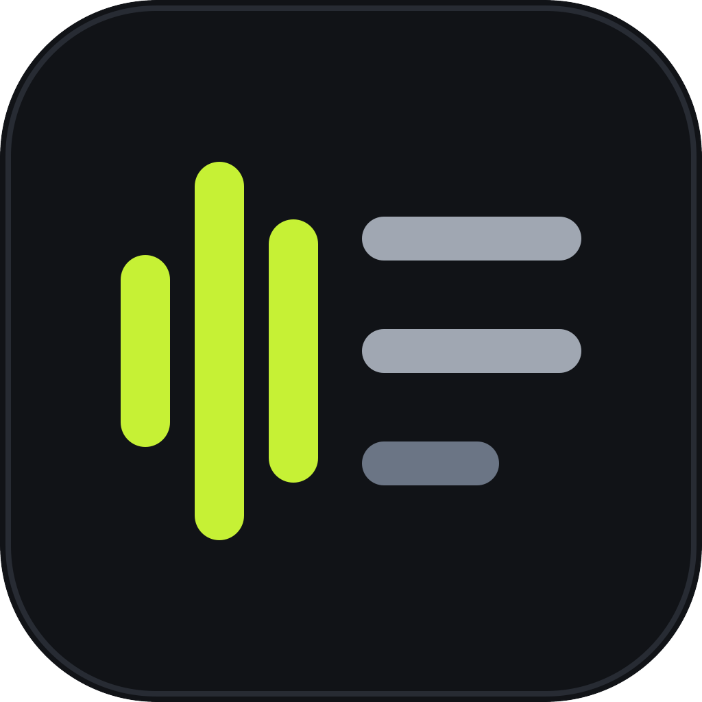

<div align="center">



# Scribe

**A privacy-first Mac app that turns recorded calls into transcripts, on your own machine.**

Built for calls that mix Hindi and English in one sentence. It doesn't write notes: it produces an accurate transcript and makes pasting it into Claude a single action.

[](#run-it)
[](#run-it)
[](#privacy-and-what-it-costs)
[](LICENSE)

</div>

---

## Why this exists

Most of my calls mix Hindi and English inside a single sentence. Transcription tools are built for one language at a time, so Hinglish comes back with wrong words, the wrong script, or both. The tools that handle it well are cloud services, and I'd rather not send private conversations to someone else's platform to get notes out of them.

So I compared eight models on one 5 minute clip against a human-corrected reference, and built the app around what held up locally. Scribe records or imports a call, saves it, transcribes it on the Mac, and lets me paste the text into Claude. Cloud models are there as optional second opinions, switched on by hand and flagged every time.

## The idea that makes it work: the cloud is a second opinion, never the pipeline

The obvious design is to send every call to the most accurate cloud model. It's also the design that breaks the one promise the app exists to keep. The second obvious design is to run several local models and have Claude merge their output into one better transcript. I tried it. On the same clip the merge scored 20.9% against 22.9% for the best local model alone. That's a 2.0 point gain, inside the noise, and it cost about 80,000 tokens per merge plus a cloud call.

So Scribe makes two rules and holds them:

```
1. Audio goes to a transcriber. Local is the default and needs no network.
2. Claude only ever reads text. It can't take audio, so it reviews existing
   transcripts and is never the first step.
```

The local engine runs whisper.cpp with the settings the comparison favoured: beam search, no carry-over between segments, no voice activity detection, full-precision models.

```bash
whisper-cli -m <model.bin> -f <16 kHz mono wav> -l en -bs 5 -mc 0 -sns \
  --prompt "<names and terms you set>" -otxt -of <output>
```

Accuracy comes before speed here. A call can take as long as it needs to transcribe.

### Worked through on a real clip

One 5 minute Hindi and English clip, scored against a human-corrected reference with a rough, script-independent word error measure (words are reduced to a consonant skeleton so Devanagari and Roman spellings compare). It's lenient: good for ranking, not for absolute accuracy.

| Engine or model | Error | Where it runs |
|---|---|---|
| Gemini | 11.0% | Cloud. The reference was corrected from Gemini's text, so this score is flattered. |
| ElevenLabs Scribe | 16.1% | Cloud |
| Oriserve Whisper-Hindi2Hinglish | 22.9% | Local, the default for Hinglish |
| Whisper large-v3, full precision | 27.9% | Local, the default for English-only calls |
| Qwen3-ASR | 32.2% | Local, not used |
| Shunya | 52% or worse | Local, not used |
| Whisper large-v3-turbo with voice activity detection | Failed or didn't load | Not used |
| Whisper-based Hinglish previews (Trelis) | Failed or didn't load | Not used |

Read it with the limits in view: one clip, one meeting, one reference. The local default trails Gemini by 11.9 points. Oriserve ran at about 4 times real time on an M-series Mac with 16 GB: 2.5 minutes for a 10 minute 54 second recording. By the same ratio a 90 minute call projects to about 22.5 minutes. That figure is arithmetic, not a measurement, and nothing past 10 minutes 54 seconds has been timed.

## Privacy and what it costs

Each claim below is something you can check without trusting me.

- **The local engine opens no connection.** The only code that talks to the network is the three cloud transcribers and the Claude reviewer in [`Sources/Providers.swift`](Sources/Providers.swift). Check with `grep -n URLSession Sources/*.swift`.
- **No analytics, no accounts, no backend.** [`build.sh`](build.sh) compiles `Sources/*.swift` against system frameworks only. There are no third-party packages.
- **The app declares one usage string, the microphone.** Computer audio asks for Screen & System Audio Recording at runtime, only when you tick it.
- **API keys live in the macOS Keychain**, service `com.akshaybengani.scribe`. Check with `security find-generic-password -s com.akshaybengani.scribe`. They're never written to preferences, `meta.json`, or exports.
- **Audio and transcripts stay in** `~/Library/Application Support/Scribe/`.

The caveats, in the same breath:

- The app is ad-hoc signed and **not sandboxed**, so macOS doesn't enforce the no-network claim. The code does, and the grep above is how you confirm it.
- When you pick Gemini or ElevenLabs, your audio goes to Google or ElevenLabs. When you ask Claude to review, the transcript text (not audio) goes to Anthropic. A banner stays on screen while a cloud engine is chosen or running, and the detail screen asks before each send.
- **One gap in that promise:** if a cloud engine is your default, the automatic send after a recording or import shows the banner but doesn't ask first. The confirmation is built on the detail screen only. It's tracked as KG-01 in the [SRS](docs/SRS.md).
- The setup scripts in `setup/` use the network to install Homebrew packages and download models. The app never runs them.

What the privacy costs:

| Choice | Cost | What helps |
|---|---|---|
| Local by default | About 11.9 points more error than the best cloud model on the one clip measured | Second opinions as tabs, and a names-and-terms field for recurring spellings |
| Full-precision models, beam search | Slow: about 4 times real time | Time doesn't matter here, and the job runs in the background |
| Models on disk | The two defaults are about 1.5 GB and 2.9 GB | Point Settings at a smaller file if you need to |
| No speaker labels | Diarization is off and the cloud prompts ask for none | None yet |

## What it does

- **Record** the microphone, optionally with computer audio (Teams, Meet, browser calls) through ScreenCaptureKit, mixed into one 16 kHz mono AAC file. Pause and resume.
- **Import** any audio file. It's copied into the library and the original is left alone.
- **Choose a call language** per recording: Hindi + English, or English only (a separate model file and prompt).
- **Transcribe** with Local (whisper.cpp), Gemini, or ElevenLabs Scribe. Claude reviews existing transcripts as text only.
- **Keep every opinion** as a tab, one per engine, and ask for more with "Get another opinion".
- **Organise** recordings in nested, colour-coded folders (nine colours, any depth). Move by menu or drag and drop. Deleting a folder moves its contents up and never deletes audio.
- **Hand off**: copy the transcript, copy it with an editable notes prompt for Claude, or export it as text. Export the audio too.

### What's built and what isn't

| Area | State |
|---|---|
| Recording, import, local transcription, folders, settings, export | Built. The local pipeline is verified end to end. |
| Gemini, ElevenLabs, and Claude requests | Built, never run: no API keys were present when the app was written |
| Live microphone and computer audio capture, drag and drop, dark mode | Built, not yet exercised |
| Chunking for very long recordings | Not built |
| Confirmation before every cloud send | Not built (see the gap above) |
| Compare-opinions view, command palette, search | Not built |
| Graphite design system in the app | Not built. The app uses system styling. |

Of 135 requirements in the SRS, 20 are verified, 94 are built but untested, and 21 are planned.

## Where things live

```
~/Library/Application Support/Scribe/
  Models/                     ggml model files
  Recordings/
    folders.json              the folder list
    <id>/
      audio.m4a               or audio.<ext> for an import
      meta.json               title, language, folder, and every transcript
```

## Repository layout

```
Sources/
  main.swift          window, menu, launch
  Model.swift         Recording, Folder, TranscriptResult, RecordingStore
  Audio.swift         recorder, AAC writer, ScreenCaptureKit capture, player, waveform
  Providers.swift     whisper.cpp, Gemini, ElevenLabs, Claude, job runner
  Settings.swift      settings, Keychain
  SettingsView.swift  the AI Models sheet
  Library.swift       folder tree, drag and drop
  Views.swift         home, detail, transcript tabs, export
setup/                model download and conversion, comparison runs
docs/
  PRD.md              product requirements, decisions, risks
  SRS.md              software requirements, data model, traceability
  design/GRAPHITE.md  the dark design system the UI will move to
assets/branding/      icon
build.sh              compile, bundle, ad-hoc sign, install
```

## Run it

You need an Apple Silicon Mac on macOS 14 or later, the Xcode command line tools (for `swiftc`), and [Homebrew](https://brew.sh).

```bash
git clone https://github.com/akshaybengani/scribe.git
cd scribe
brew install whisper-cpp uv
```

**Get the models.** Run the setup scripts in this order. The first installs the engine and conversion tooling, the second downloads and converts the default Hinglish model.

```bash
./setup/download-models.sh
./setup/hinglish-models.sh
```

These scripts were written for the model comparison, so they also fetch comparison models (several GB beyond the defaults). Read them first and delete the lines for models you don't want.

For English-only calls, put Whisper large-v3 where the app expects it:

```bash
curl -L -o "$HOME/Library/Application Support/Scribe/Models/ggml-large-v3-f16.bin" \
  https://huggingface.co/ggerganov/whisper.cpp/resolve/main/ggml-large-v3.bin
```

**Build and install.**

```bash
./build.sh                  # compile, bundle, ad-hoc sign, install to /Applications
NO_INSTALL=1 ./build.sh     # compile and bundle only, prints the .app path
```

Open Scribe, then open **AI Models** to check that Local shows Ready. Allow the microphone when asked. For computer audio, allow Scribe under System Settings > Privacy & Security > Screen & System Audio Recording, then quit and reopen.

Cloud engines are optional. Add a key and the exact model name in **AI Models** to use one. Keys go to the Keychain.

## Tests

There's no automated test suite yet. What was checked by hand in the build session:

| Check | Count or scope |
|---|---|
| Local pipeline | End to end on a real clip |
| Audio writer and format conversion | Synthetic audio |
| Folder logic | 15 checks |
| English-only path | A 30 second slice |
| UI snapshots | Light mode |

What wasn't checked: live microphone recording, live computer audio, every cloud request, drag and drop, and dark mode. The [SRS](docs/SRS.md) marks each requirement as verified, built but untested, or planned, and lists 17 known gaps.

## Documents

- [PRD](docs/PRD.md): the problem, users, goals, principles, success measures, risks, open questions, and the reason behind each decision.
- [SRS](docs/SRS.md): requirements with IDs, the data model, state and error handling, and a table tracing each requirement to its source file.
- [Graphite](docs/design/GRAPHITE.md): the design tokens for the dark and light themes.

## How it was built

I specify the product, review the result, and run it. Claude Code writes the Swift.

## Licence

[MIT](LICENSE). Use it, change it, share it.

Transcripts can be wrong. Check anything that matters against the audio before you rely on it. Recording a call may need the other participants' consent where you live, and that's yours to check, not the app's.
