<div align="center">


# Scribe

**A privacy-first Mac app that turns recorded calls into transcripts, on your own machine.**

Built for calls that mix Hindi and English in one sentence. It doesn't write notes: it produces an accurate transcript and makes pasting it into Claude a single action.

[](#run-it)
[](#run-it)
[](#privacy-and-what-it-costs)
[](LICENSE)

</div>

---

## Screenshots

Every screen exists in dark and light. By default the app follows the system theme; Settings > Appearance can pin it to Light or Dark. All data in these images is made up for the screenshots.

| Dark | Light |
|---|---|
| 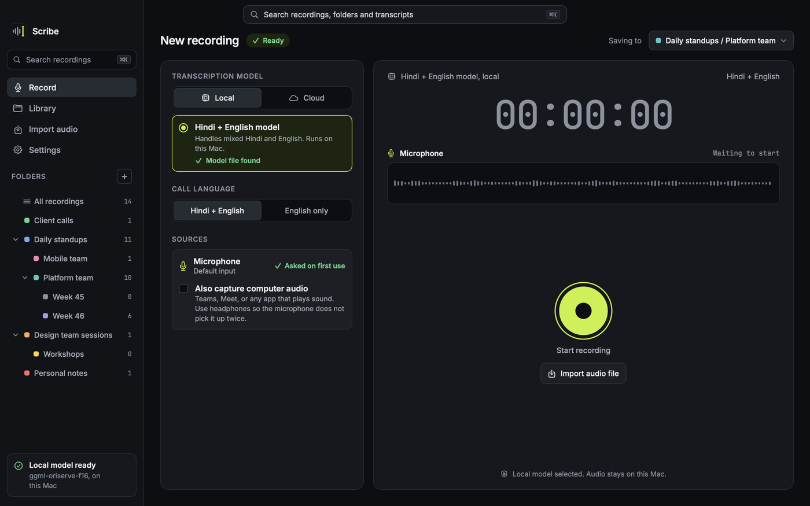 | 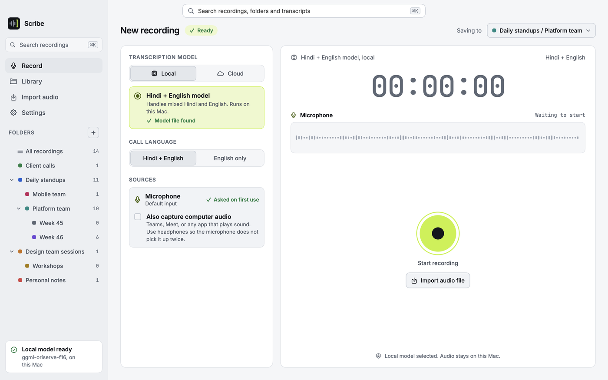 |
| **Record.** Pick a local or cloud model, then start. | **Record.** The same screen in the light theme. |
| 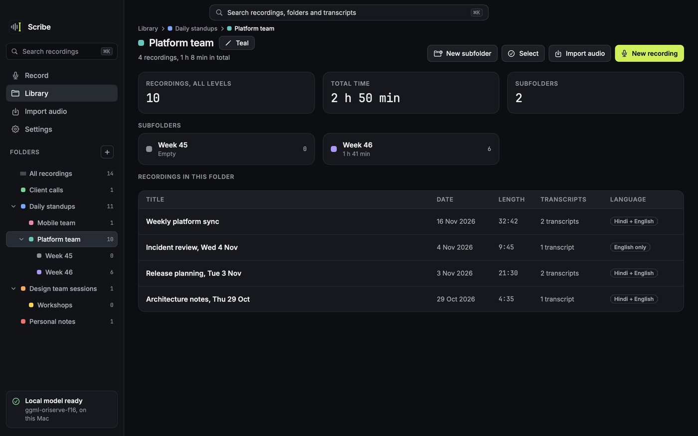 | 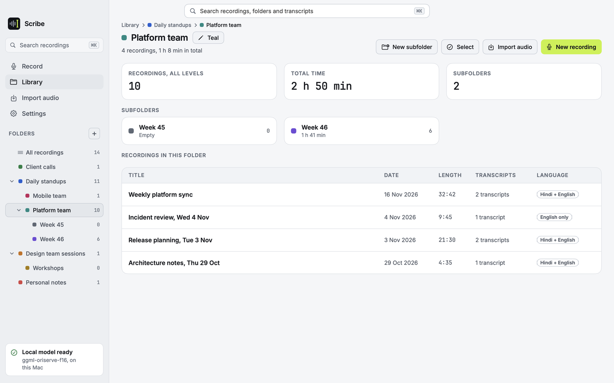 |
| **Library.** Nested, colour coded folders with totals. | **Library.** Light theme. |
| 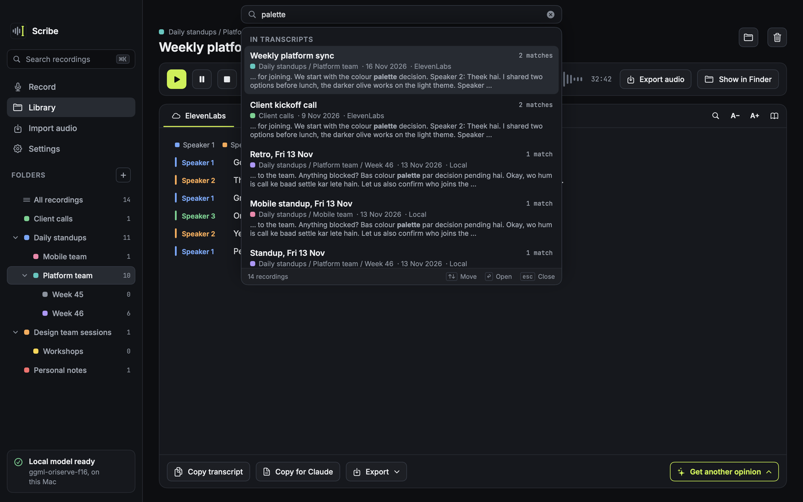 | 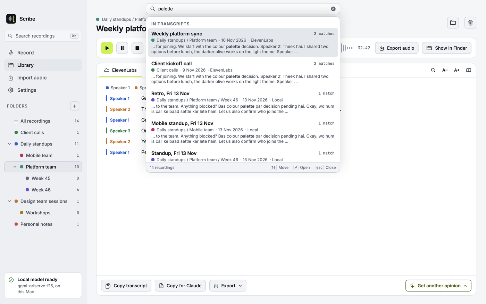 |
| **Transcript and search.** Speaker blocks, and results from every transcript under the search bar. | **Transcript and search.** Light theme. |
| 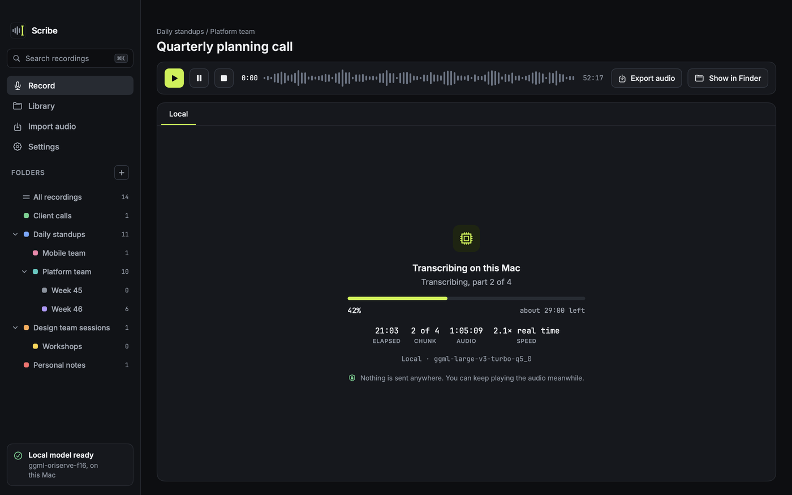 | 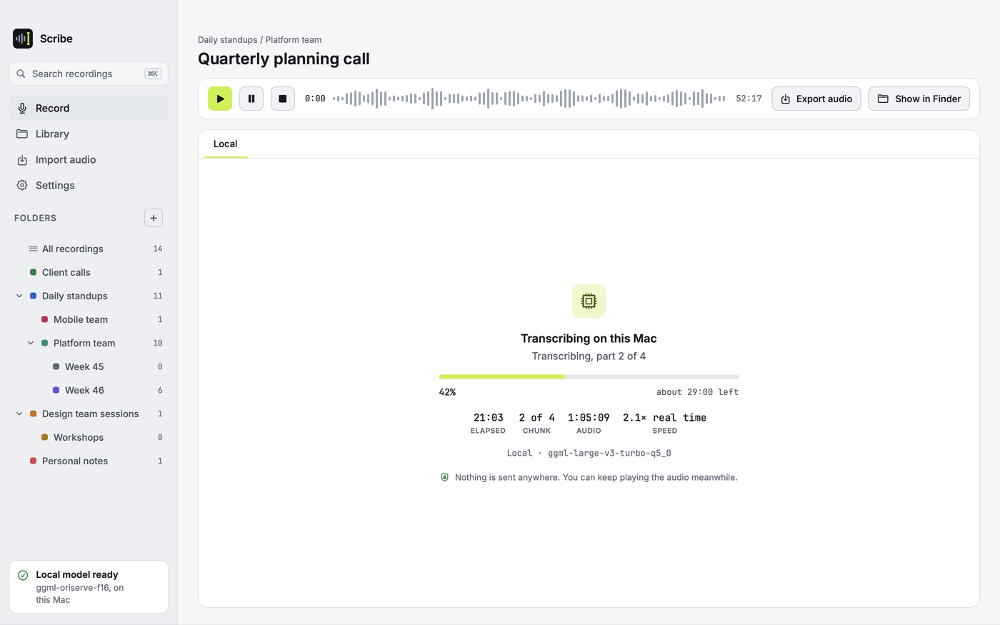 |
| **Live progress.** Percent, elapsed time, time left, and chunk x of y for long recordings. | **Live progress.** Light theme. |
| 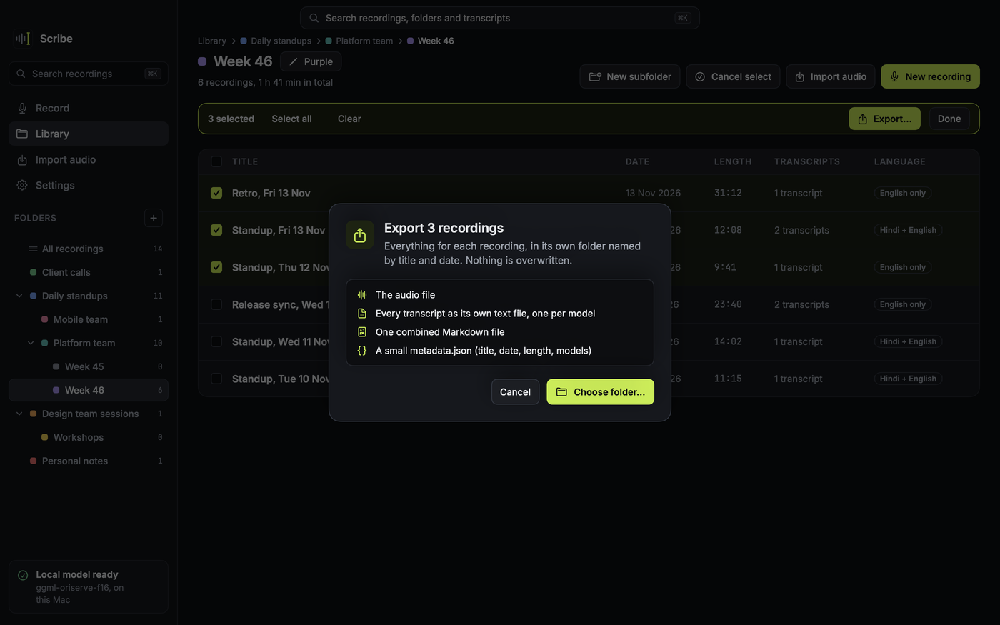 | 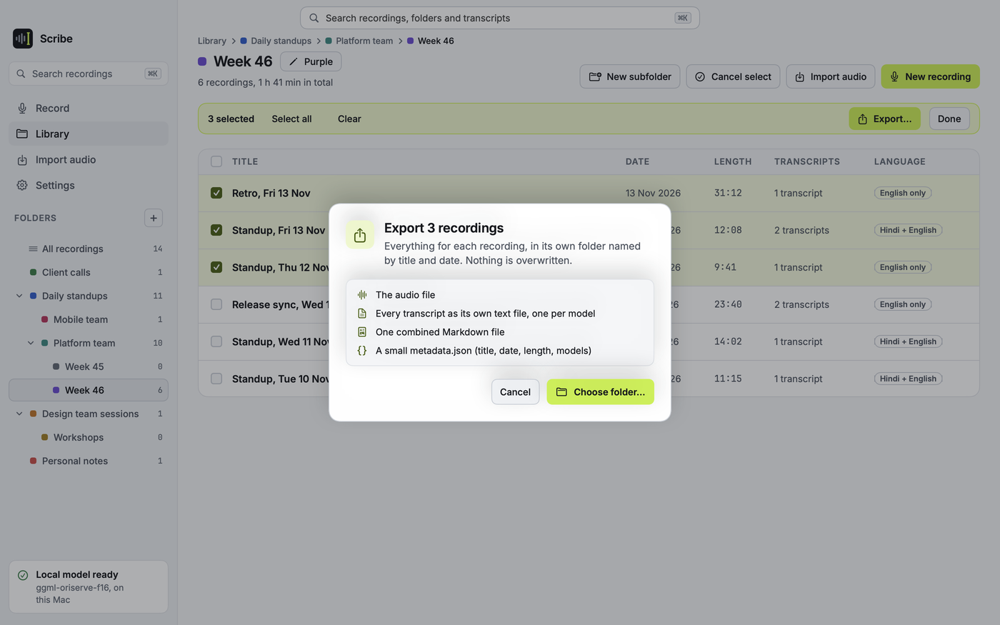 |
| **Export.** Select several recordings and export everything for each one. | **Export.** Light theme. |
| 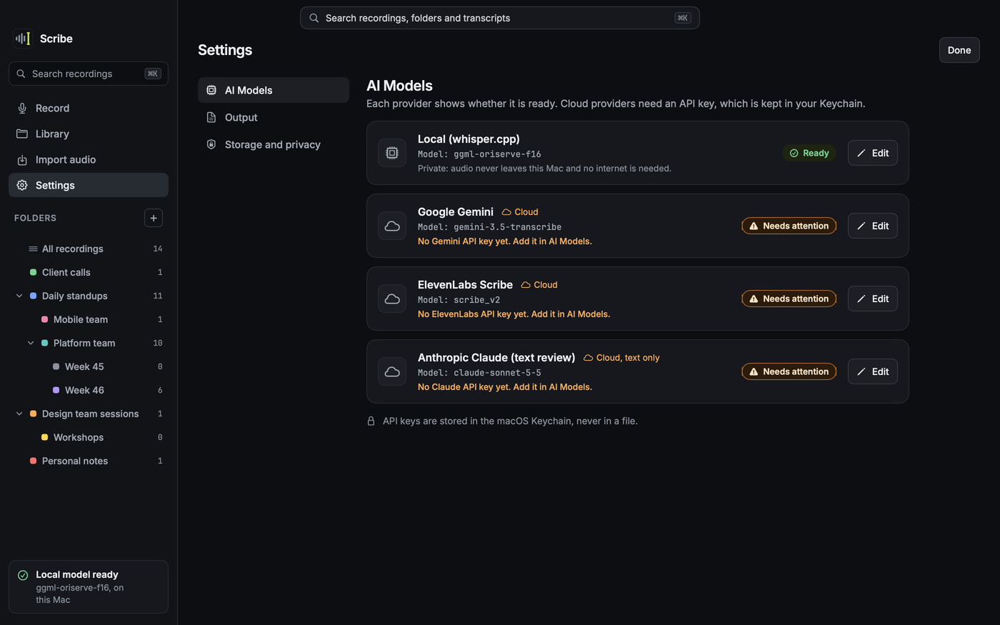 | 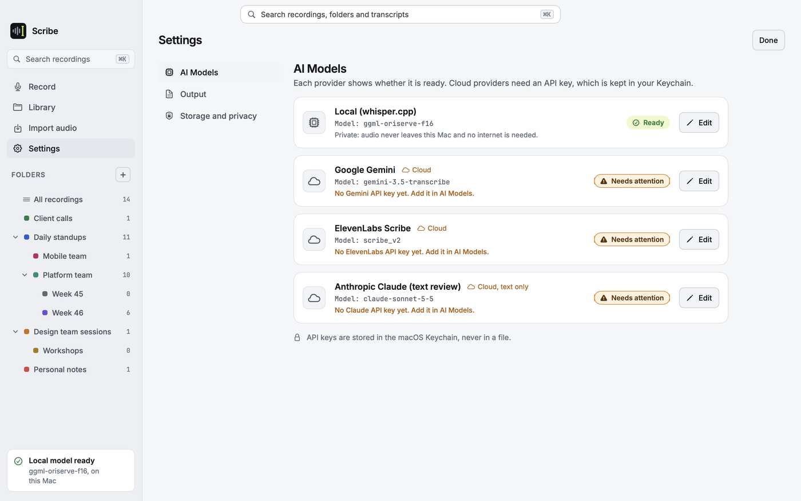 |
| **Settings, AI Models.** Each provider shows whether it is ready. | **Settings, AI Models.** Light theme. |

---

## Why this exists

Most of my calls mix Hindi and English inside a single sentence. Transcription tools are built for one language at a time, so Hinglish comes back with wrong words, the wrong script, or both. The tools that handle it well are cloud services, and I'd rather not send private conversations to someone else's platform to get notes out of them.

So I compared eight models on one 5 minute clip against a human-corrected reference, and built the app around what held up locally. Scribe records or imports a call, saves it, transcribes it on the Mac, and lets me paste the text into Claude. Cloud models are there as optional second opinions, switched on by hand and flagged every time.

## The idea that makes it work: the cloud is a second opinion, never the pipeline

The obvious design is to send every call to the most accurate cloud model. It's also the design that breaks the one promise the app exists to keep. The second obvious design is to run several local models and have Claude merge their output into one better transcript. I tried it. On the same clip the merge scored 20.9% against 22.9% for the best local model alone. That's a 2.0 point gain, inside the noise, and it cost about 80,000 tokens per merge plus a cloud call.

So Scribe makes two rules and holds them:

```
1. Audio goes to a transcriber. Local is the default and needs no network.
2. Claude only ever reads text. It can't take audio, so it reviews existing
   transcripts and is never the first step.
```

The local engine runs whisper.cpp with the settings the comparison favoured: beam search, no carry-over between segments, no voice activity detection, full-precision models.

```bash
whisper-cli -m <model.bin> -f <16 kHz mono wav> -l en -bs 5 -mc 0 -sns \
  --prompt "<names and terms you set>" -otxt -of <output>
```

Accuracy comes before speed here. A call can take as long as it needs to transcribe.

### Worked through on a real clip

One 5 minute Hindi and English clip, scored against a human-corrected reference with a rough, script-independent word error measure (words are reduced to a consonant skeleton so Devanagari and Roman spellings compare). It's lenient: good for ranking, not for absolute accuracy.

| Engine or model | Error | Where it runs |
|---|---|---|
| Gemini | 11.0% | Cloud. The reference was corrected from Gemini's text, so this score is flattered. |
| ElevenLabs Scribe | 16.1% | Cloud |
| Oriserve Whisper-Hindi2Hinglish | 22.9% | Local, the default for Hinglish |
| Whisper large-v3, full precision | 27.9% | Local. English-only calls default to large-v3-turbo at 5-bit instead. |
| Qwen3-ASR | 32.2% | Local, not used |
| Shunya | 52% or worse | Local, not used |
| Whisper large-v3-turbo with voice activity detection | Failed or didn't load | Not used |
| Whisper-based Hinglish previews (Trelis) | Failed or didn't load | Not used |

Read it with the limits in view: one clip, one meeting, one reference. The local default trails Gemini by 11.9 points. Oriserve ran at about 4 times real time on an M-series Mac with 16 GB: 2.5 minutes for a 10 minute 54 second recording. By the same ratio a 90 minute call projects to about 22.5 minutes. That figure is arithmetic, not a measurement, and nothing past 10 minutes 54 seconds has been timed.

## Privacy and what it costs

Each claim below is something you can check without trusting me.

- **The local engine opens no connection.** Network code sits in four files: the cloud transcribers and the Claude reviewer in [`Sources/Providers.swift`](Sources/Providers.swift), the upload helper they share in `Sources/Progress.swift`, and the model-list requests in `Sources/ModelCatalog.swift` (with `Sources/Settings.swift` holding the session). `LocalTranscriber` has none, and neither does the Claude Code server in `Sources/MCP/`. Check with `grep -rn URLSession Sources`.
- **No analytics, no accounts, no backend.** [`build.sh`](build.sh) compiles `Sources/*.swift` and `Sources/MCP/main.swift` against system frameworks only. There are no third-party packages.
- **The Claude Code server is read-only.** `scribe-mcp` reads the library from disk and never writes to it. Transcript text reaches Anthropic only when you ask Claude Code for a call.
- **The app declares one usage string, the microphone.** Computer audio asks for Screen & System Audio Recording at runtime, only when you tick it.
- **Model lists need a key.** The only extra network calls are the providers' list-models requests, and they run only after you enter that provider's key, to that provider's own host.
- **API keys live in the macOS Keychain**, service `com.akshaybengani.scribe`. Check with `security find-generic-password -s com.akshaybengani.scribe`. They're never written to preferences, `meta.json`, or exports.
- **Audio and transcripts stay in** `~/Library/Application Support/Scribe/`.

The caveats, in the same breath:

- The app is signed with a local certificate (or ad-hoc if you haven't made one) and is **not sandboxed**, so macOS doesn't enforce the no-network claim. The code does, and the grep above is how you confirm it.
- When you pick Gemini or ElevenLabs, your audio goes to Google or ElevenLabs. When you ask Claude to review, the transcript text (not audio) goes to Anthropic. A banner stays on screen while a cloud engine is chosen or running, and the detail screen asks before each send.
- **One gap in that promise:** if a cloud engine is your default, the automatic send after a recording or import shows the banner but doesn't ask first. The confirmation is built on the detail screen only. It's tracked as KG-01 in the [SRS](docs/SRS.md).
- The setup scripts in `setup/` use the network to install Homebrew packages and download models. The app never runs them.

What the privacy costs:

| Choice | Cost | What helps |
|---|---|---|
| Local by default | About 11.9 points more error than the best cloud model on the one clip measured | Second opinions as tabs, and a names-and-terms field for recurring spellings |
| Full-precision models, beam search | Slow: about 4 times real time | Time doesn't matter here, and the job runs in the background |
| Models on disk | The Hinglish default is about 1.5 GB | Point Settings at a smaller file if you need to |
| No encryption, no backup | Audio and transcripts sit unencrypted on one Mac | Export copies everything out |
| Speaker labels only from providers | Local returns none | ElevenLabs and Gemini 3.5 Transcribe return them |

## What it does

- **Record** the microphone, computer audio (Teams, Meet, browser calls, through ScreenCaptureKit), or both, mixed into one 16 kHz mono AAC file. Turn the microphone off to record only what the Mac plays, for example a webinar. Pause and resume with the large button or Space. Stop is click-only, so a stray key can't end a call.
- **Remove speaker echo** (on by default): the microphone runs through Apple's on-device voice processing, the echo canceller FaceTime uses, so a call played on the Mac's speakers isn't recorded a second time by the mic. Only the cleaned voice channel is kept. Measured on a MacBook Air, speaker sound from another app in the mic fell from -14.5 to -48 dBFS.
- **Import** any audio file. It's copied into the library and the original is left alone.
- **Choose a call language** per recording: Hindi + English, or English only (a separate model file and prompt, large-v3-turbo at 5-bit by default).
- **Transcribe** with Local (whisper.cpp), Gemini, or ElevenLabs Scribe. Claude reviews existing transcripts as text only.
- **Long recordings:** Gemini and ElevenLabs get recordings over 60 minutes in parts of about 25 minutes (29 minutes for Gemini with speaker labels), cut at the quietest point and stitched in order. Failed parts retry. A job screen shows percent, elapsed, time left, and chunk x of y.
- **Local jobs run one at a time**, so two copies of a large model never share the GPU. Others wait with "Waiting for another local transcription to finish". The Mac stays awake while a job runs (closing the lid still pauses it). If whisper-cli fails, its full output is saved as `whisper-error.log` in the recording's folder.
- **Search** every title, folder, and transcript from the bar at the top (Cmd+K), then find within a transcript.
- **Speaker labels** appear only when a provider returns them (ElevenLabs and Gemini 3.5 Transcribe). Nothing extra is added otherwise.
- **Pick models from each provider's own list** once a key exists, audio models first. The names load from the provider's list-models API.
- **Choose a theme** in Settings > Appearance: System, Light, or Dark, all in the Graphite design. Shortcuts: Space to play and pause (and to pause a recording), Cmd+R to start recording, Cmd+N, Cmd+Shift+N, Cmd+, , Cmd+E, and Cmd+K.
- **Use calls from Claude Code**: a bundled MCP server lets Claude Code list, search, and import your calls on request. See [Use it from Claude Code](#use-it-from-claude-code).
- **Keep every opinion** as a tab, one per engine, and ask for more with "Get another opinion".
- **Organise** recordings in nested, colour-coded folders (nine colours, any depth). Move by menu or drag and drop. Deleting a folder moves its contents up and never deletes audio.
- **Hand off**: copy the transcript, copy it with an editable notes prompt for Claude, or export it as text. The export dialog writes the audio, a text file per transcript, one combined Markdown file, and a metadata.json for each recording.
- **Delete** asks first, and removes the audio and its transcripts together.

### What's built and what isn't

| Area | State |
|---|---|
| Recording, import, local transcription, folders, settings, export of one transcript | Built. The local pipeline was verified end to end before the latest changes. |
| Graphite design, system light or dark, keyboard shortcuts, delete with confirmation | Built, not yet exercised |
| Chunking for Gemini and ElevenLabs, retries, job progress numbers | Built, not yet exercised. No screen reads the progress numbers yet. |
| Search bar (Cmd+K) and find bar, job progress screen, model picker with Refresh models, export dialog with metadata.json, bundled fonts | Built, not yet exercised. The export dialog isn't opened from a multi-selection yet, and the Settings sheet still has a text field for model names. |
| Speaker labels | ElevenLabs and Gemini 3.5 Transcribe built, not yet exercised |
| Gemini, ElevenLabs, and Claude requests | Built, never run: no API keys were present. The default Gemini model goes through the Interactions API, written from Google's docs and never sent. |
| Live microphone and computer audio capture, drag and drop | Built, not yet exercised |
| Claude Code MCP server (`scribe-mcp`) | Built. All five tools checked by hand against a real library, and connected in Claude Code. |
| Settings > Appearance, Settings > Claude Code, Space to pause a recording, click-only Stop | Built, not yet exercised |
| Computer-audio-only recording (microphone off) | Built, not yet exercised |
| Remove speaker echo | Built. The echo canceller was measured outside the app (below); recording with it in the app is not yet exercised. |
| Local job queue, keep awake during jobs, whisper-error.log | Built, not yet exercised |
| Lenient read of whisper-cli output | Built and checked on the 75 minute call that failed before (see Tests) |
| Confirmation before every cloud send | Not built (see the gap above) |
| Local chunking, compare-opinions view, Windows | Not built |

Of 181 requirements in the SRS, 15 are verified, 147 are built but untested, and 19 are planned.

## Where things live

```
~/Library/Application Support/Scribe/
  Models/                     ggml model files
  Recordings/
    folders.json              the folder list
    <id>/
      audio.m4a               or audio.<ext> for an import
      meta.json               title, language, folder, and every transcript
```

## Repository layout

```
Sources/
  main.swift          window, menu, launch
  Model.swift         Recording, Folder, TranscriptResult, RecordingStore
  Audio.swift         recorder, AAC writer, ScreenCaptureKit capture, player, waveform
  Providers.swift     whisper.cpp, Gemini, ElevenLabs, Claude, job runner
  Chunker.swift       split long recordings at the quietest point
  Progress.swift      job progress, whisper-cli progress parsing, speaker labels
  ModelCatalog.swift  curated names and each provider's list-models API
  Settings.swift      settings, Keychain, model catalogs
  SettingsView.swift  the Settings sheet, including Appearance and Claude Code
  MCP/main.swift      scribe-mcp, the read-only MCP server for Claude Code
  Search.swift        global search index and query engine
  SearchBar.swift     the search bar and results panel
  Export.swift        export engine
  ExportFlow.swift    the export dialog and the full export writer
  Theme.swift         Graphite tokens and components, light and dark
  Library.swift       sidebar and folder tree, drag and drop
  RecordViews.swift   record and import screens
  DetailView.swift    recording screen: player, tabs, opinions
  TranscriptViews.swift  transcript blocks, find bar, job progress screen
  ModelPickers.swift  model picker and Refresh models
  Dialogs.swift       confirmations and dialogs
  Views.swift         window shell and UI state
setup/                model download and conversion, comparison runs
docs/
  PRD.md              product requirements, decisions, risks
  SRS.md              software requirements, data model, traceability
  design/GRAPHITE.md  the Graphite design tokens, light and dark
assets/branding/      the Caret wave logo, app icon
assets/fonts/         Inter and JetBrains Mono (SIL OFL)
build.sh              compile, bundle, sign, install
```

## Run it

You need an Apple Silicon Mac on macOS 14 or later, the Xcode command line tools (for `swiftc`), and [Homebrew](https://brew.sh).

```bash
git clone https://github.com/akshaybengani/scribe.git
cd scribe
brew install whisper-cpp uv
```

**Get the models.** Run the setup scripts in this order. The first installs the engine and conversion tooling, the second downloads and converts the default Hinglish model.

```bash
./setup/download-models.sh
./setup/hinglish-models.sh
```

These scripts were written for the model comparison, so they also fetch comparison models (several GB beyond the defaults). Read them first and delete the lines for models you don't want.

For English-only calls, put Whisper large-v3-turbo (5-bit) where the app expects it:

```bash
curl -L -o "$HOME/Library/Application Support/Scribe/Models/ggml-large-v3-turbo-q5_0.bin" \
  https://huggingface.co/ggerganov/whisper.cpp/resolve/main/ggml-large-v3-turbo-q5_0.bin
```

**Build and install.**

```bash
./build.sh                  # compile, bundle, sign, install to /Applications
NO_INSTALL=1 ./build.sh     # compile and bundle only, prints the .app path
```

Open Scribe, then open Settings (Cmd+, ) to check that Local shows Ready. Allow the microphone when asked. For computer audio, allow Scribe under System Settings > Privacy & Security > Screen & System Audio Recording, then quit and reopen.

Cloud engines are optional. Add a key in Settings to use one, and pick or type a model name. Keys go to the Keychain.

**Stable signing (optional).** macOS ties the microphone and screen recording grants to the app's signing requirement, and an ad-hoc signature changes on every build, so the grants are asked again after each rebuild. `build.sh` signs with a local self-signed certificate named "Scribe Local Signing" when it finds one, and falls back to ad-hoc otherwise. [`assets/README.md`](assets/README.md) has the one-time commands to make the certificate and to check the requirement stays the same. The private key never goes in the repository.

## Use it from Claude Code

Scribe ships an MCP server, `scribe-mcp`, inside the app. Claude Code can use it to find and import your calls. It's read-only: Claude can list, search, and read calls, but never change or delete them. It reads the library straight from disk, so it works even when Scribe is closed.

`build.sh` builds the server from the app's own model, search, and export code, so search results and the imported Markdown match the app exactly. Add it to Claude Code once, for every project:

```bash
claude mcp add --scope user scribe -- /Applications/Scribe.app/Contents/MacOS/scribe-mcp
```

Settings > Claude Code shows whether it's added, with the command and the server path to copy. Remove it with `claude mcp remove scribe -s user`.

| Tool | What it does |
|---|---|
| `get_latest_call` | Import the most recent call with its full transcript |
| `search_calls` | The same global search as Cmd+K: titles, folders, and every transcript. `"Quotes"` match an exact phrase |
| `get_call` | Import any call by id (a short prefix works), with one chosen transcript or all of them |
| `list_recent_calls` | The latest calls with date, length, language, and folder |
| `list_folders` | The folder tree, and the calls inside a folder |

Then ask Claude Code things like "import my latest Scribe call" or "search my calls for 'design portal'".

## Tests

There's no automated test suite yet. What was checked by hand in the build session:

| Check | Count or scope |
|---|---|
| Local pipeline | End to end on a real clip |
| Audio writer and format conversion | Synthetic audio |
| Folder logic | 15 checks |
| English-only path | A 30 second slice, with large-v3 at full precision |
| UI snapshots | Light mode, of the earlier UI |
| Claude Code MCP server | All five tools, unknown ids, missing transcripts, and bad requests, over stdio against a real library |
| Long local transcription | A 75 minute Hinglish call that failed in the app: whisper-cli itself finished in 14 minutes (2.7 GB peak). Its output held one broken UTF-8 byte inside a hallucinated line, which made the app's strict read discard the whole transcript. The lenient read keeps all of it. |
| Echo cancellation | MacBook Air mic and speakers, speech played by another app for 6 seconds: -14.5 dBFS in the mic without voice processing, -48.1 dBFS with it |

Those runs predate the progress output, the new English default, chunking, search, export, model lists, and the Graphite redesign, so the SRS counts those as built but untested.

What wasn't checked: live microphone recording, live computer audio, every cloud request and model list request, drag and drop, and dark mode. The [SRS](docs/SRS.md) marks each requirement as verified, built but untested, or planned, and lists 23 known gaps. No automated tests are committed.

## Documents

- [PRD](docs/PRD.md): the problem, users, goals, principles, success measures, risks, open questions, and the reason behind each decision.
- [SRS](docs/SRS.md): requirements with IDs, the data model, state and error handling, and a table tracing each requirement to its source file.
- [Graphite](docs/design/GRAPHITE.md): the design tokens for the dark and light themes, the search bar, and progress.

Open items: a live Gemini test with a key, an ElevenLabs live test later, and Windows later.

## How it was built

I specify the product, review the result, and run it. Claude Code writes the Swift.

## Licence

[MIT](LICENSE). Use it, change it, share it.

Transcripts can be wrong. Check anything that matters against the audio before you rely on it. Recording a call may need the other participants' consent where you live, and that's yours to check, not the app's.
